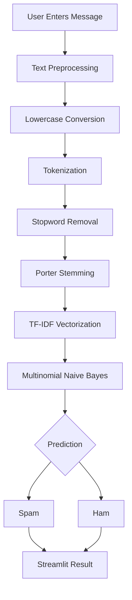

<div align="center">

# 🛡️ SpamShield
### Email & SMS Spam Classifier

**An end-to-end Natural Language Processing and Machine Learning application for intelligent spam detection.**

[](https://ashiwany-spam-classifier.streamlit.app/)
[](https://www.python.org/)
[](https://scikit-learn.org/)
[](https://streamlit.io/)
[](https://github.com/Ashiwany25/Email-Spam-Classifier/actions)

### [🚀 Live Application](https://ashiwany-spam-classifier.streamlit.app/) | [💻 Source Code](https://github.com/Ashiwany25/Email-Spam-Classifier) | [📊 Dataset](https://www.kaggle.com/datasets/uciml/sms-spam-collection-dataset)

</div>

---

## 📌 Project Overview

**SpamShield** is a machine learning-powered web application designed to classify text messages as **Spam** or **Ham (Legitimate)**.

The project demonstrates a complete NLP workflow, from text preprocessing and feature extraction to model training, evaluation, and cloud deployment.

It uses **TF-IDF Vectorization** and **Multinomial Naive Bayes** to identify patterns commonly associated with spam messages.

The application is developed using Python and Streamlit and is publicly accessible through Streamlit Community Cloud.

> **Important:** The model was trained on the SMS Spam Collection dataset. Although users can submit email text, its performance on real-world email datasets has not been separately validated.

---

## 🌐 Live Demo

<div align="center">

### 🛡️ Try SpamShield

[](https://ashiwany-spam-classifier.streamlit.app/)

**Enter a message → Analyze → Get Spam/Ham Prediction**

</div>

### How to Use

1. Open the live application.
2. Enter or paste an SMS or email message.
3. Click **Analyze message**.
4. View the classification result.
5. Review the estimated spam probability.

### Example Input

**Spam example:**

```text
Congratulations! You have won a free prize.
Click here to claim your reward immediately.
```

**Legitimate example:**

```text
Hi, are we still meeting tomorrow at 10 AM?
Please confirm when you get a chance.
```

These are illustrative examples; predictions can vary.

---

## ✨ Key Features

| Feature | Description |
|---|---|
| 🧠 Machine Learning | Spam classification using Multinomial Naive Bayes |
| 📝 NLP Processing | Tokenization, stopword removal, and stemming |
| 📊 TF-IDF | Converts textual messages into numerical features |
| ⚡ Instant Predictions | Predicts spam or legitimate messages |
| 📈 Probability Display | Shows estimated spam probability |
| 🎨 Modern UI | Responsive dark-themed Streamlit application |
| 📉 Model Evaluation | Accuracy, precision, recall, F1-score, confusion matrix |
| ☁️ Cloud Deployment | Hosted using Streamlit Community Cloud |
| 🔄 Automated Training | GitHub Actions workflow |
| 🔓 Open Source | Publicly accessible project source code |

---

## 📊 Model Performance

The model was evaluated using a held-out 20% test split after removing duplicate messages.

| Evaluation Metric | Result |
|:---|---:|
| **Accuracy** | **98.16%** |
| Precision (Spam) | 97.46% |
| Recall (Spam) | 87.79% |
| F1-Score (Spam) | 92.37% |
| Unique Messages | 5,169 |
| Test Samples | 1,034 |

### Confusion Matrix

| Actual / Predicted | Ham | Spam |
|---|---:|---:|
| **Ham** | 900 | 3 |
| **Spam** | 16 | 115 |

### Performance Interpretation

- **1,015 out of 1,034** test messages were correctly classified.
- Only 3 legitimate messages were incorrectly flagged as spam.
- 16 spam messages were incorrectly classified as legitimate.
- The model performs well on the held-out SMS test set, but additional validation is required for production use.

> Metrics are based on the saved evaluation results in `models/metrics.json`. Spam probability estimates are not guaranteed to be calibrated.

---

## 🧠 Machine Learning Architecture



### Processing Pipeline

**Step 1 — Data Collection**

The SMS Spam Collection dataset contains messages labeled as spam or ham.

**Step 2 — Data Cleaning**

Remove duplicate records and prepare the text and target labels.

**Step 3 — Text Preprocessing**

- Convert text to lowercase.
- Extract alphanumeric tokens.
- Remove English stopwords.
- Apply Porter stemming.

**Step 4 — Feature Extraction**

TF-IDF converts text into numerical feature vectors.

**Step 5 — Model Training**

Train a Multinomial Naive Bayes classifier using labeled training data.

**Step 6 — Model Evaluation**

Evaluate the classifier using accuracy, precision, recall, F1-score, and a confusion matrix.

**Step 7 — Deployment**

Save the trained pipeline with Joblib and load it in the Streamlit application.

---

## 🛠️ Technology Stack

<div align="center">


</div>

| Category | Technology |
|---|---|
| Programming Language | Python |
| Machine Learning | Scikit-learn |
| Natural Language Processing | NLTK, Regex |
| Text Preprocessing | Stopword Removal, Porter Stemming |
| Feature Extraction | TF-IDF |
| Classification Algorithm | Multinomial Naive Bayes |
| Data Processing | Pandas |
| Model Serialization | Joblib |
| Web Framework | Streamlit |
| Cloud Hosting | Streamlit Community Cloud |
| Version Control | Git, GitHub |
| Automation | GitHub Actions |

---

## 📁 Project Structure

```text
Email-Spam-Classifier/
│
├── .github/
│   └── workflows/
│       └── train-model.yml
│
├── .streamlit/
│   └── config.toml
│
├── data/
│   ├── spam.csv
│   └── README.txt
│
├── models/
│   ├── spam_pipeline.joblib
│   ├── metrics.json
│   └── README.txt
│
├── src/
│   └── preprocessing.py
│
├── app.py
├── train.py
├── requirements.txt
├── .gitignore
└── README.md
```

### Important Files

| File | Purpose |
|---|---|
| `app.py` | Streamlit web application |
| `train.py` | Model training and evaluation |
| `src/preprocessing.py` | Text cleaning and preprocessing |
| `data/spam.csv` | SMS spam dataset |
| `models/spam_pipeline.joblib` | Saved trained machine learning pipeline |
| `models/metrics.json` | Model evaluation results |
| `requirements.txt` | Python dependencies |
| `.streamlit/config.toml` | Streamlit UI configuration |
| `.github/workflows/train-model.yml` | Automated training workflow |

---

## ⚙️ Installation and Setup

### Prerequisites

- Python 3.11 or a compatible version
- pip
- Git
- VS Code or another Python IDE

### 1. Clone the Repository

```bash
git clone https://github.com/Ashiwany25/Email-Spam-Classifier.git
cd Email-Spam-Classifier
```

### 2. Create a Virtual Environment

**macOS / Linux**

```bash
python3 -m venv .venv
source .venv/bin/activate
```

**Windows**

```powershell
py -m venv .venv
.venv\Scripts\Activate.ps1
```

### 3. Install Dependencies

```bash
python -m pip install -r requirements.txt
```

### 4. Run the Application

```bash
streamlit run app.py
```

The application will usually open at:

```text
http://localhost:8501
```

---

## 🔄 Model Training

The repository includes a trained model.

To retrain it using the dataset:

```bash
python train.py
```

This script:

1. Loads the dataset.
2. Removes duplicate messages.
3. Converts labels into numerical classes.
4. Splits the data into training and testing sets.
5. Trains the TF-IDF + Naive Bayes pipeline.
6. Evaluates the model.
7. Saves the model and evaluation metrics.

### Generated Files

```text
models/spam_pipeline.joblib
models/metrics.json
```

---

## ☁️ Streamlit Cloud Deployment

SpamShield is deployed using Streamlit Community Cloud.

### Deployment Steps

1. Push the complete project to GitHub.
2. Visit [Streamlit Community Cloud](https://share.streamlit.io/).
3. Sign in using GitHub.
4. Click **Create app**.
5. Select your repository.
6. Choose the `main` branch.
7. Set the main file path to `app.py`.
8. Click **Deploy**.

### Deployment Configuration

| Setting | Value |
|---|---|
| Repository | `Ashiwany25/Email-Spam-Classifier` |
| Branch | `main` |
| Main File | `app.py` |
| Hosting | Streamlit Community Cloud |

**Live URL:** https://ashiwany-spam-classifier.streamlit.app/

---

## 📂 Dataset Information

**Dataset:** SMS Spam Collection

**Source:** [Kaggle](https://www.kaggle.com/datasets/uciml/sms-spam-collection-dataset)

**Original Repository:** [UCI Machine Learning Repository](https://archive.ics.uci.edu/dataset/228/sms+spam+collection)

The dataset contains SMS messages classified into two categories:

- **Ham (0):** Legitimate messages
- **Spam (1):** Unsolicited messages

The original dataset contains 5,572 messages, including duplicates.

After duplicate removal, the training dataset contains 5,169 unique messages.

---

## ⚠️ Limitations

- The model is trained primarily on English SMS messages.
- Real-world email classification performance has not been separately validated.
- New spam patterns may reduce prediction accuracy.
- False positives and false negatives are possible.
- The model does not inspect attachments or detect malicious URLs.
- Spam probability estimates may not be calibrated.
- This application should not replace production email security systems.

---

## 🔮 Future Enhancements

- [ ] Train and evaluate on real email datasets.
- [ ] Compare Logistic Regression, SVM, and other classifiers.
- [ ] Add transformer-based models such as BERT.
- [ ] Introduce multilingual spam detection.
- [ ] Add model explainability.
- [ ] Improve probability calibration.
- [ ] Add automated model testing.
- [ ] Build a REST API for external integrations.
- [ ] Support batch message classification.
- [ ] Add performance monitoring.

---

## 🎯 Learning Outcomes

This project demonstrates practical experience in:

- Natural Language Processing
- Text preprocessing and feature engineering
- Supervised machine learning
- Classification model evaluation
- Model serialization
- Streamlit application development
- Cloud deployment
- Git and GitHub
- End-to-end machine learning project development

---

## 🙏 Acknowledgements

- [CampusX SMS Spam Classifier](https://github.com/campusx-official/sms-spam-classifier) — reference and inspiration
- [UCI Machine Learning Repository](https://archive.ics.uci.edu/) — dataset source
- [Scikit-learn](https://scikit-learn.org/) — machine learning tools
- [Streamlit](https://streamlit.io/) — application framework

---

## 👨‍💻 Developer

<div align="center">

### Ashiwany Kumar

**Computer Science & Engineering (AI & ML)**

Haldia Institute of Technology

[](https://github.com/Ashiwany25)

</div>

---

<div align="center">

### ⭐ Support This Project

If you found this project useful, consider giving it a ⭐ on GitHub.

**Made with ❤️ using Python, NLP, Machine Learning, and Streamlit.**

[🚀 Live Demo](https://ashiwany-spam-classifier.streamlit.app/) | [💻 GitHub Repository](https://github.com/Ashiwany25/Email-Spam-Classifier)

</div>